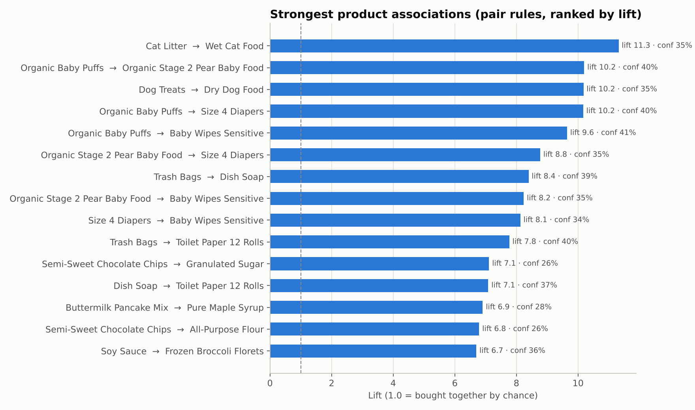
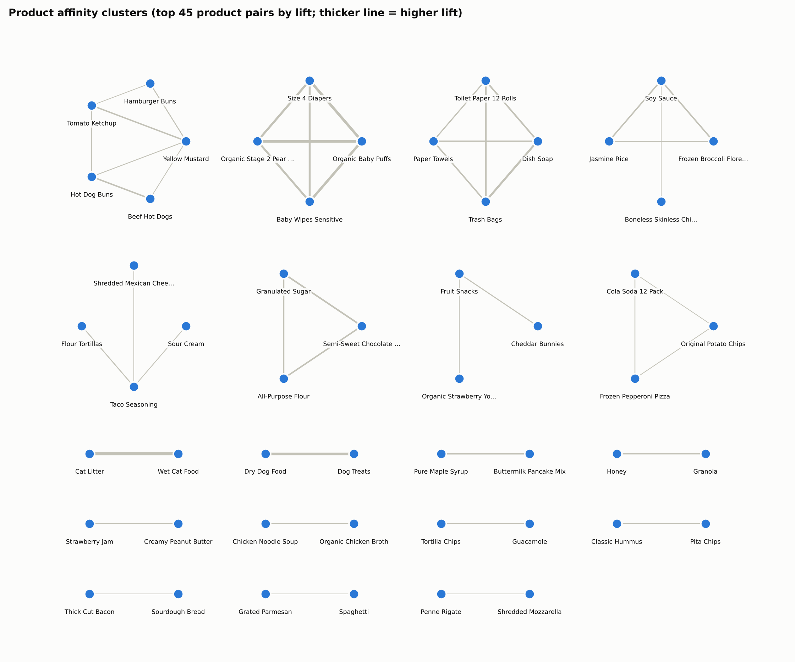
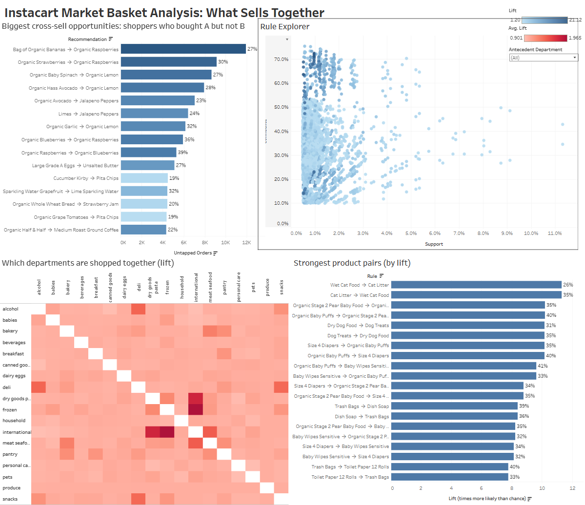

# Market Basket & Product Association Analysis (Instacart)

Which grocery products get bought together, and where are the cross-selling opportunities?

I work with retail supermarket data day to day, and "what sells with what" is one of the questions that keeps coming up. I wanted to do it properly, using association rules with lift instead of just counting co-occurrences, so I used the Instacart dataset as a public stand-in.

**Tools:** Python (pandas, numpy, matplotlib, networkx), SQL (SQLite), Tableau Public

**Dashboard:** [Instacart Market Basket Analysis on Tableau Public](https://public.tableau.com/app/profile/abrar.ahmed.syed4247/viz/InstacartMarketBasketAnalysis_17951940099710/MarketBasketDashboard)

## Data

The Instacart Market Basket Analysis dataset on Kaggle has about 3M grocery orders from 200K+ customers and around 50K products across 134 aisles and 21 departments.

- `orders`: one row per order (customer, order number, day of week, hour)
- `order_products__prior`: one row per item in an order, with add-to-cart position and a reorder flag
- `products`, `aisles`, `departments`: the product hierarchy

**Note on the results below:** the numbers and charts in this repo come from a smaller sample I generated in the same schema (`src/generate_sample_data.py`, about 49.5K orders and 120 products). That way the whole thing runs in a minute without a Kaggle account. The same pipeline runs on the full dataset; see `data/README.md`.

## How it works

1. **Load into SQLite.** The schema is in `sql/01_schema.sql`, with indexes added after the bulk load.
2. **EDA in SQL** (`sql/03_eda.sql`): KPIs, top products, department penetration, order timing, basket sizes, and which products get added to the cart first.
3. **Pair rules in SQL** (`sql/04_pair_affinity.sql`): a self-join on order lines gives support, confidence and lift for every product pair, plus the same at department level.
4. **Apriori in Python** (`src/apriori.py`): I wrote the algorithm myself instead of using mlxtend, mostly to make sure I understood the candidate generation and pruning. It finds frequent itemsets of up to 3 items and generates rules with support, confidence, lift, leverage and conviction.
5. **Check SQL against Python.** The pipeline compares lift for every pair rule from both methods and stops if they disagree. On the sample, the largest difference was 0.0005 (rounding).
6. **Score cross-sell opportunities.** For each strong rule A → B, I count the orders that had A but not B. Those are the people you could actually show a "frequently bought together" prompt to.
   - The score is `untapped orders × confidence × ln(lift)`.
7. **Export** charts to `outputs/figures` and CSVs to `outputs/tableau` for the dashboard.

Quick reference on the metrics:
- **Support:** the share of all orders that contain the items.
- **Confidence (A → B):** of the orders with A, the share that also have B.
- **Lift:** confidence divided by B's overall support. Above 1 means they go together more than chance; around 1 means no relationship.

## Results (sample data)

| | |
|---|---|
| Orders | 49,497 |
| Customers | 4,000 |
| Avg basket size | 9.6 items |
| Reorder rate | 56% |
| Frequent itemsets (min support 0.5%) | 5,503 |
| Rules (lift ≥ 1.2, confidence ≥ 10%) | 3,708 |



The strongest pairs are what you'd expect from "mission" shopping: baby care (diapers, wipes, baby food), pet food with litter or treats, and household restocks like trash bags, dish soap and paper towels. Lift is around 8–11 for these. They aren't huge by volume, but they are very predictable.



The 3-item rules are where confidence really jumps:

| Cart has | Suggest | Confidence | Lift |
|---|---|---|---|
| All-Purpose Flour + Granulated Sugar | Semi-Sweet Chocolate Chips | 64% | 21.1 |
| Size 4 Diapers + Stage 2 Pear Baby Food | Organic Baby Puffs | 72% | 21.0 |

Ranking by lift alone isn't the full picture, though. When I ranked by untapped orders instead, the top opportunities moved to high-traffic items:

| A | B | Confidence | Lift | Orders with A but not B |
|---|---|---|---|---|
| Tortilla Chips | Guacamole | 35% | 4.6 | 3,235 |
| Tomato Ketchup | Yellow Mustard | 39% | 6.5 | 2,285 |
| Organic Garlic | Organic Lemon | 32% | 2.3 | 6,149 |
| Organic Blueberries | Organic Raspberries | 36% | 2.1 | 5,938 |
| Sparkling Water Grapefruit | Lime Sparkling Water | 32% | 2.9 | 4,466 |

Rough sizing: if a prompt converted 5% of those orders, the top 10 ideas would add about 2,750 units in this sample. The 5% is an assumption; in practice you would A/B test it.

Other charts are in `outputs/figures`: support vs confidence for all rules, the department affinity heatmap, top products, and orders by day and hour.

## Tableau dashboard

The dashboard pulls the main views together: the top cross-sell opportunities, the strongest product pairs, the department affinity heatmap, and a scatter of every rule that can be filtered by department.

[](https://public.tableau.com/app/profile/abrar.ahmed.syed4247/viz/InstacartMarketBasketAnalysis_17951940099710/MarketBasketDashboard)

## What I'd recommend from this

- **Bundles** for the high-lift clusters (baby, pet, baking, taco night), shown as a single add-to-cart or a "complete the recipe" prompt.
- **Produce-led prompts.** Produce has the most untapped orders, and bananas, avocado and spinach are often the first things added to the cart, so that's a natural point to trigger a suggestion.
- **Shelf placement.** Keep same-department pairs next to each other (ketchup and mustard, berries, seltzer flavors), and use department lift when planning endcaps.

## Limitations / what I'd do next

- Run it on the full dataset with a lower support threshold. Many interesting rules on a 50K-product catalog will sit below 0.5% support.
- Lift is biased toward rare items, so I'd add a minimum count and look at conviction more.
- Add price or margin data so opportunities are ranked by revenue instead of units.
- Do the analysis at the aisle level too, since product-level rules can be noisy.

## Running it

```bash
pip install -r requirements.txt
bash run_all.sh              # generates sample data and runs everything
```

To run on the real data, download it into `data/raw/` (steps in `data/README.md`), then:

```bash
python src/run_pipeline.py --data-dir data/raw --sample-orders 200000 --min-support 0.002
```

## Repo layout

```
src/generate_sample_data.py   sample data in the Instacart schema
src/apriori.py                Apriori + rule generation
src/run_pipeline.py           load -> SQL -> rules -> scoring -> charts/exports
sql/                          schema, EDA queries, pair/department affinity
outputs/figures/              charts
outputs/tableau/              CSVs used for the Tableau dashboard
```
